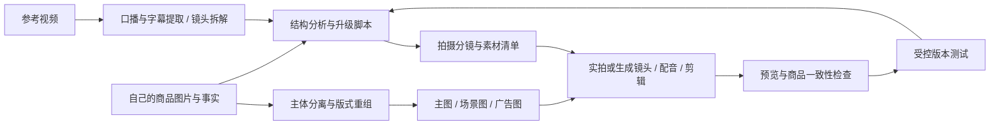

# 参考视频与商品素材创作流程

方案记录：用户确认同时需要文案与分镜、商品图片重组、完整 UGC 视频及测试版本。现已接入首版本地项目、素材处理、AI文案和图文草稿制作；当前可用范围及未完成项见 [实现说明](README.md)。真实商品与参考视频的完整 UGC 验收仍未完成。

## 最终使用方式

在现有电商工作台增加“创意工作室”：导入参考视频和自己的商品资料，查看逐段拆解，修改文案与分镜，选择图片构图，审阅视频，记录版本表现。Codex、Hermes 和 Harness 使用同一份项目资料和任务状态。

每个项目形成一套可复用的创作包：

| 产物 | 内容 |
| --- | --- |
| 参考拆解 | 带时间码的口播、画面字幕、镜头边界、关键帧、演示动作、音乐/音效位置 |
| 结构分析 | 开头吸引点、受众问题、产品出现时机、卖点与证据、异议处理、行动引导 |
| 升级文案 | 原文对照、问题说明、三个不同切入点、目标语言版本、卖点依据 |
| 拍摄分镜 | 每段时长、台词、画面、机位/动作、所需素材、字幕和声音，以及缺失素材 |
| 图片资产 | 商品主体、背景、装饰、文字位置、配色与版式说明；重组后的主图、场景图和广告图 |
| 视频资产 | 可编辑工程、基础片、开头变量版本、字幕文件、配音、封面、输出检查结果 |
| 测试记录 | 版本对应的改动、目标指标、观察窗口、播放/点击/转化数据与下一轮假设 |

公开播放量、点赞量可用于筛选参考；它们不能单独证明带货转化或解释爆款的因果。拆解形成待验证假设，实际效果用自己的投放或自然流量结果检验。

## 一、视频拆解与文案升级

1. 保存来源与可使用范围。优先导入可用的原视频文件；平台页面链接、手机能播放、能读到评论，都不能保证能取得完整媒体文件。受限平台可由用户通过平台允许的保存方式提供原片。
2. 用 FFprobe 获取时长、帧率、旋转和音轨；FFmpeg 分离音频、提取关键帧。镜头边界与字幕统一使用媒体时间戳，保留对原片位置的映射。
3. ASR 提取“说了什么”，OCR 提取“画面写了什么”，多模态分析描述“演示了什么”。三个来源分别保留，不能把画面字幕冒充口播。置信度不足、专有名词、数字或两者冲突时列为待校对。
4. 镜头变化检测给出切点；语义分析再区分开头、问题、演示、证据与行动引导。视觉切点不等于语义段落。
5. 给每一项建议附上原片时间码与自己的商品事实依据。可以调整开头、信息顺序、演示动作、节奏和异议处理；新增功能、效果数字或使用体验必须有相应依据。
6. 输出三套切入点和可拍分镜。采用实拍、授权演员、已有产品素材、生成背景或合成镜头的组合；人物/声音使用获授权素材或虚构形象。

首轮推荐先比较三个开头，保持正文、商品素材、受众与测试条件一致；下一轮再比较演示顺序。每轮记录一个明确假设、比较对象和目标指标。无需把所有视觉与文案同时改动后再猜原因。

## 二、商品图片解构与重组

先建立元素表：商品主体与包装、背景、手部/道具、文字、标识、阴影、配色、留白和视觉层级。每个元素记录用途、位置和来源。

- 商品主体：分割产生蒙版，边缘和透明区域需检查；主体比例、颜色、包装文字与规格作为固定事实。
- 文字：OCR 恢复文字内容与位置，重新排版为可编辑文字；文字被遮挡时保持未知，不能补写成事实。
- 背景与氛围：按目标人群和场景更换，保留产品本身的一致性；可为白底主图、使用场景、功能展示和多语言广告图分别构图。
- 可编辑交付：除成图外，保留主体文件、蒙版、文字/字体与位置清单、背景和布局配置，便于复用。

单张照片或压平的广告图不能保证恢复原始 PSD 图层、被遮挡的产品背面、精确字体或光照。SAM 2 提供对象分割与视频跟踪；平面海报可尝试 Canva 的 image-to-design，但照片不保证良好转换。优先使用自己的高质量商品原图和可编辑设计文件。

生成图片时以自己的商品原图作参考，并逐张对照 SKU、外观、标签与尺寸。需要严格可读的包装或价格文字可使用主体合成加独立文字排版；不能靠生成画面猜测产品事实。

## 三、完整 UGC 视频

制作顺序为：确认产品事实和脚本 → 明确分镜 → 准备/拍摄素材 → 生成缺少的非事实性场景 → 配音与字幕 → 剪辑与混音 → 预览校对 → 版本测试。

三种生产路线可在同一工程混用：

| 路线 | 适用内容 | 推荐执行方式 |
| --- | --- | --- |
| 实拍改进 | 开箱、操作、手持、真实效果、质感特写 | 分镜与拍摄清单指导重拍，FFmpeg/编辑器剪辑 |
| 混合制作 | 已有产品视频，加新开头、场景图、字幕和配音 | 商品实拍保持真实，图像工具补充视觉，模板统一渲染 |
| 生成镜头 | 场景、概念表达、合成人物口播或缺失 B-roll | 使用可用生成工具逐镜头生成，审阅后再组装；不保证一次生成完整长片的商品一致性 |

输出比例、字幕安全区、响度与时长按目标平台的当前规范检查。第一条样片通过后再批量生成变量版本。画面中的商品特征、口播和字幕必须一致；实际效果、对比实验和使用体验不能由生成画面代替验证。

## 四、方案期的工具能力核对（历史快照）

下表保留方案制定时的状态，当前实现与验证结果见 [实现说明](README.md)，不能把旧表中的“未接入”当作最新状态。

| 环节 | 可选工具/技能 | 本项目目前的状态 |
| --- | --- | --- |
| 素材发现 | 手机采集、已有调研与证据模块 | 可发现和读取部分公开界面；完整视频获取未验收 |
| 音视频预处理 | FFmpeg / FFprobe | 本机命令存在；尚未对本流程的真实参考片验收 |
| 语音转写 | 现有 Whisper 命令；whisper.cpp；Descript 转写工具 | `whisper --help` 可响应并列出 SRT/JSON；模型、质量和实际输入仍待验收。Descript 工具入口存在，额度和真实文件流程未检查 |
| 关键帧 OCR | 现有 Vision OCR；按需求考虑 PaddleOCR | Vision OCR 已用于手机截图；尚未对视频关键帧建立质量基线 |
| 镜头变化 | PySceneDetect | 当前检查的 Python 环境未安装；计划接入 |
| 结构/文案 | 多模态模型、ad-creative、ai-video-script | 技能可用；每条素材仍需产品资料与真实证据，当前未生成成品文案 |
| 主体分割 | SAM 2；简单抠图可考虑 rembg | 当前检查的 Python 环境未安装；速度和硬件路径待实测 |
| 图片重组 | imagegen；可编辑设计可结合 Canva/Adobe | 工具入口可用，尚未在本项目用实际商品验收 |
| 视频镜头/口播 | Lovart 视频生成、HeyGen 合适的视频路线 | 工具入口可见，未检查额度、授权素材、账号权益或生成质量 |
| 自动剪辑与变量版本 | FFmpeg 模板；需要复杂可编辑模板时评估 Remotion / Hyperframes | 尚未建立创作模板；渲染器许可单独核对 |
| 记录与复盘 | 当前共享任务、研究证据、版本记录 | 现有基础任务只记录 queued/cancelled，不能当成创作执行器 |

“工具存在”“工具可调用”“完整业务流程已验收”分别记录。没有用实际文件调用生成、转写或渲染，因此这里不承诺成片质量、耗时、费用或全自动成功率。

## 五、接入现有工作台

沿用已有共享后台与 MCP 入口，新增创意项目、素材资产、时间线、分镜、变量与审阅结果；媒体文件放在私有存储，账本只保留受控引用、来源、哈希、处理状态和衍生关系。运行素材、参考片、截图、口令和在线服务签名地址不得进入公开源码。

创作执行器需要独立补上：任务领取与续租、真实阶段回执、取消检查点、资源上限、输出检查以及异常状态。调用外部生成服务后若结果不明，先按任务 ID 查询，保留 UNKNOWN，避免重复付费生成。

建议阶段：`import → probe → transcribe/ocr → shots → analyze → script → image_assets → video_assets → assemble → review → export`。文案和图片可在视频阶段之前分别交付，某个生成服务失败也应保留已完成的拆解和文案。

建议新增的 MCP 工具（均未实现）：`creative_project_create`、`creative_reference_import`、`creative_analyze`、`creative_script_propose`、`creative_image_plan`、`creative_render_start`、`creative_job_get`、`creative_review_save`。它们复用同一创意项目 ID，不能每个智能体单独建一套事实和素材库。

本地机器优先做预处理、OCR、转写和模板渲染；大型分割模型或视频生成按真实样片的质量与资源占用再决定本机、服务器或在线工具。在线工具会接收提交的素材，需据资料的可用范围选择执行位置。

## 六、第一条完整样片的验收

输入为一条可用参考视频、自己的商品原图/规格、目标平台/国家/语言，以及希望使用的拍摄路线。有真人或声音时明确其可使用范围。

1. 一份时间线拆解：每段可定位回原片，口播、画面字幕和语义描述分别可核对。
2. 三套升级脚本和一套可拍分镜：所有产品主张能追溯到资料，未知项列出。
3. 一套商品元素清单与三个图片方案：主图、使用场景、广告版式；主体及包装文字核对后再接受。
4. 一条基础 UGC 视频和两个开头变量版本：先通过一条基础片，再扩展；原始素材、可编辑工程、字幕和输出参数可追溯。
5. 每条成品通过字幕可读性、画音一致、商品事实、素材完整性和目标平台规格检查；最终观看审阅与真实效果测试分别记录。

此验收尚未执行。合成测试只能证明流水线接口工作，不能替代真实参考片、实际商品和观看质量验收。

## 可复用的上游能力

- [whisper.cpp](https://github.com/ggml-org/whisper.cpp)：本地语音识别，官方支持 Apple Silicon 的 Metal/Core ML 等加速路径；适合评估本机执行。是否有足够速度须用自己的音频测试。
- [PySceneDetect](https://www.scenedetect.com/)：镜头变化检测和视频切分，提供可复用的场景时间码。
- [SAM 2](https://github.com/facebookresearch/sam2)：图片对象分割和视频对象跟踪；代码/权重与第三方组件许可按各自文件记录，安装和硬件条件另行实测。
- [Remotion](https://www.remotion.dev/docs/)：程序化视频与参数化模板。商业使用和分发按其[官方许可说明](https://www.remotion.dev/docs/license)核对，不能笼统视为无限制免费组件。
- [FFmpeg](https://ffmpeg.org/documentation.html)：预处理、时间线拼装、字幕与音频处理；分发方式和所用构建的许可另行登记。

吸收这些项目的接口与处理方法，保留版本、许可和验证证据；不把整套上游项目未经检查复制进源码或当前共享运行配置。
