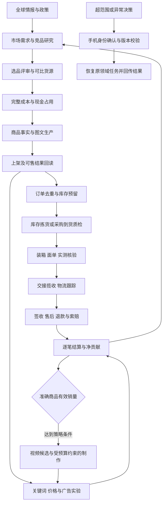

# 跨境电商自动经营闭环

## 目标与实现选择

目标是在预先确认的店铺、商品、仓库和预算内无人值守运行；例外决策推送手机，决定后恢复原任务，并回传真实执行结果。自动化权限以服务端授权为准，不能从聊天中的目标描述推导付款、采购或广告额度。

当前采用现有持久工作流推进、领域连接器执行、专职 Agent 按需判断的组合。会话承担工程和经营判断；订单、任务、预算、批准和外部回执保存在后台，不能只留在聊天里。此方案是基于现有代码与成本的选择，尚无证据称其为全局最优解。

| 方案 | 收益 | 代价与选择 |
| --- | --- | --- |
| 全自由 Agent 群聊 | 非结构化探索灵活 | 等待、重启、预算及重复外部动作难以管控，不作为订单执行主体 |
| 全固定脚本/RPA | 稳定、可预测 | 页面变化和复杂选品判断适应性弱；保留给明确适配与重复操作 |
| 持久工作流 + 按需 Agent | 状态可恢复、执行可验证，同时保留判断能力 | 需要真实平台/仓库适配；当前优先沿用，不先迁移全部框架 |

现有 extension runtime、autonomy、listing submission 和通知 outbox 已提供部分持久、去重、预算与 UNKNOWN 语义。先复用；多进程、多节点和长期等待规模超过现实现后，再用可复现实测决定是否迁移 Temporal 等编排系统。框架不会替代外部动作幂等与对账。[Temporal 活动与幂等说明](https://docs.temporal.io/activity-definition)。

## 全链路及真实完成条件

| 环节 | 输入与输出 | 不能用来代替完成的内容 |
| --- | --- | --- |
| 情报与研究 | 来源、生效/观察时间、目标市场、需求信号、价带、竞品原链接/图、样本和反例 | 搜索结果数或评论数不能冒充实时销量 |
| 选品与供应链 | 精确SKU/变体、材质/配件/包装、两家以上可比报价、供货稳定性、样品及权利核验 | 多SKU促销最低价、零售价或不同结构款不能当同款采购报价 |
| 成本与评审 | 原币与汇率时点、采购/税费/运费/平台/广告/损耗/退款、资金占用、敏感性及拒绝理由 | 未知成本不能填零；有毛利不等于有净贡献 |
| 商品资料与图片 | 事实证据、俄语标题/卖点/关键词、图像元素拆解、商品身份锁定、主图/细节/场景、质量回查 | 图像相似、生成成功或本地审阅不能证明实物结构和素材权利 |
| 上架 | 精确店铺/类目/版本、允许的价格/库存、提交回执及平台可售状态 | 排队、HTTP接受、草稿或审批通过不等于可售 |
| 出单与采购 | 订单事件去重、取消重核、SKU映射、库存预留、缺货分支、受授权采购/付款及到货 | 发货单读取或采购草稿不等于已处理订单 |
| 装箱与发货 | 订单行、拣货/质检、箱型与包材、扫码/实测重、面单/报关、仓库确认、交接与揽收 | 装箱算法和运费估算不等于实物装箱、打印、发货或揽收 |
| 物流与售后 | 包裹/运单事件、超时、拒收/丢失、证据、索赔期限、退款和回款核对 | 已发通知或人工已阅不等于异常解决 |
| 客服与增长 | 对应订单会话、事实引用、发送回执、接管；库存约束、小预算实验、消耗/归因与止损 | 回复草稿、CTR、GMV或未经归因的ROAS不能替代最终利润 |
| 结算与品牌 | 订单费用关联、退款/赔付、结算差异、净贡献、质量反馈和品牌适配 | 热销榜、短期订单量不能直接触发无预算品牌扩张 |

订单行、SKU、库存批次、采购行、包裹、运单与费用需要明确关联。覆盖库存履约/采购履约、拆单、多包裹、多承运商、部分到货、取消和逆向退货；采购批次可供多笔订单，订单也可从多个库存批次出货。

## 图片与视频策略

图片先做商品身份和事实核验，再拆解构图、背景、光影、材质表现、文字层、图标、细节及场景。参考的可学习表现手法与不可复用的品牌/人物/素材权利分开记录；每张输出绑定原图、事实版本、设计版本与实际文件哈希。重构图片不得改变商品形状、配件数量、接口、尺寸或未经核实的功能。

默认先图文上架试销；展示、使用演示和UGC风格视频在准确商品出现可信有效销量后再评估。初始建议门槛是至少一笔真实有效交易，后续按贡献、退货和预算调优，不声称该门槛最优。全店销售、待付款/取消订单、不同SKU、发货记录数、用户手填效果报表以及陈旧数据均不能单独解锁自动视频。销量接口还未达到该合同前保持延后；明确手动制作入口与历史版本保留。真实UGC与AI广告的来源和声明分别管理。

## 自动执行与手机决策

例行操作使用可撤销、限时的长期授权：店铺/市场/仓库/SKU范围、允许动作、单次/每日/累计金额、库存/折扣/退款/广告限制。各 Agent 共用一个预算账本。预算未给定保持待决，不能自行填默认消费额度。授权内日常订单无需逐单询问；新供应商、高额采购、亏损/资质风险、额度扩大等转决策。

决策申请至少绑定原任务、动作、准确对象、金额/币种、候选方案、理由、输入版本、授权范围及有效期。手机流程为：通知投递 → 可信身份进入 → 批准/驳回/修改 → 服务端重核版本、权限、有效期和幂等键 → 恢复原任务 → 外部执行 → 回读结果。通知已送达、已打开、已批准、已执行、已对账分别记录；重复点击不重复付款，过期/来源变更不沿用旧批准。自然语言确认必须解析为准确申请，不能仅凭一句“好的”批准未知金额。

移动端首选飞书企业自建应用机器人，通过官方 SDK 长连接接收消息和卡片回调，本机可先接入，不必先开放公网服务。个人微信、企业微信与 WhatsApp 保留为后续渠道。应用、租户和负责人的可信绑定与撤销必须独立验证，聊天ID不能代替审批身份。现有 localhost 服务和共享管理密钥不能直接暴露公网当手机审批入口。当前已实现本机命令收件、原任务接续、预算查询及决策核心，尚未运行真实 SDK 长连接或通过手机收件/点击回传验收；回调须在平台期限内快速应答再异步办理。[飞书回调接入](https://open.feishu.cn/document/event-subscription-guide/callback-subscription/receive-and-handle-callbacks)。

## 任务、记忆与自我维护

所有流程保存准确范围、事件/幂等键、输入哈希、任务与动作状态、预算消耗、派发意图、外部ID、回执和下一步。状态须区分等待外部、等待资料、待决策、部分成功、失败和结果未知。结果未知先核对原请求，不重新下单。重启、重复回调、租约过期、取消和撤权纳入回放验收；外部副作用不能靠重跑整个脚本修复。

记忆沿用既有分层记忆和工程记忆：事实来源、失效时间、业务经验、工程复现和验证分别保存。经营结果形成待审经验，经过对照/回放后才能成为默认策略；持续进化优先产出小范围候选、回归验证和独立审查。Agent 不自行扩大工具权限、预算或修改质量门槛。

工程会话采用 [团队运行约定](AI_TEAM_OPERATIONS.md)；主后台团队档案与真实执行会话之间当前只有明确登记，尚无通用自动派工桥。按需角色覆盖市场/竞品、供应链/成本、商品/创意、履约、客服/增长、财务/合规；先交付有输入和回执的任务，避免无数据时空转模型。

## 客户端与运行方式

Codex、DeepSeek Harness 与其它已配置客户端通过同一 MCP/HTTP 领域服务读写同一份后台状态。客户端不是第二份商品库；从哪个客户端批准都须遵循同一范围、版本和预算。MCP遵循客户端/服务器架构，能力发现不能证明UI、模型和业务执行全部通过。[MCP架构说明](https://github.com/modelcontextprotocol/docs/blob/main/docs/concepts/architecture.mdx)。

验证分层记录：实际配置与工具发现、只读调用、隔离写入合同、各宿主UI/桥接、真实模型执行和实际经营结果。未做的一层保持未验收。当前本地 Mac 依赖会话及机器可用；日常 Codex 巡检不是生产级全天候 worker。常开部署、备份恢复、密钥续期、监控与跨网手机验收是无人值守投产条件。

## 价值与交付顺序

核心价值是把证据、资金和履约结果连成可复核的经营过程，降低每笔成功订单的总成本与人工接管，同时增加可持续净贡献。可积累资产是 SKU事实、供应商/质量履约历史、完整费用、素材实验及经验证的策略；Agent、报告、图片或PR数量不是价值指标。

优先计量：结算后净贡献/资金占用、端到端自动处理成功率、每百单人工决策数、重复外部动作数、异常发现及处理时长、及时发货/妥投、退货/质量投诉、索赔回收和AI成本。先测基线，再判断收益；当前不承诺无人率、节省比例或盈利。

1. 当前 Ozon/RU 候选完成真实证据、正式选品评审、准确供货及完整成本；淘汰不合格候选也是正确产出。
2. 落实默认视频延后、一键验证和独立审查，修复会污染商品证据的路径。
3. 复用原订单任务接库存/采购分支与装箱草稿，覆盖取消、缺货、并发、拆包，先做隔离端到端回执。隔离回执已在合成订单、本机批次和既有装箱草稿上验收；仓库、承运、付款和平台取消仍未接入，回执不是外部履约成功。
4. 交付版本化决策收件箱、原任务恢复、手机可信入口及实际推送/回传。
5. 接实际仓库/3PL与承运商，真实跑通一笔订单至揽收、签收和结算；随后扩大站立授权范围。
6. 再接客服、售后、广告限额/止损和策略回放，以经营结果驱动工程迭代；最后扩其它平台与品牌站点。

## 集中所需资料与授权

| 资料 | 用途 |
| --- | --- |
| 首个店铺与SKU、履约模式、库存/供应商映射 | 确认经营对象与出单分支 |
| 正式供货报价、样品/包装实测、图片权利、目标售价 | 成本/商品真实性与可售准备 |
| 试销数量、采购/付款/广告/退款额度、亏损与调价边界 | 可执行的长期授权和升级条件 |
| 仓库/3PL/WMS、承运商及线路、标签/报关模板、物流接口 | 装箱、面单、发货、跟踪与索赔 |
| 飞书自建应用/负责人绑定、常开环境；公网域名在确需远程网页时补充 | 手机审批与全天候运行 |

凭据走私有设置入口，不贴聊天或写公开文档。以上是目标与实施合同；未接入的外部执行器、手机闭环和全天候运行不能因文档完成就标为完成。
