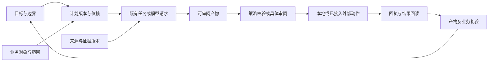

# 智能跨境运营平台 · 业务与交互设计

状态：业务流程为分阶段设计，未全部实现。面向自己和小团队；目标与范围见[产品主稿](PLATFORM_REQUIREMENTS.md)，逐项验收见[需求台账](PLATFORM_BACKLOG.md)。

2026-11-12 视觉方向按用户最新两张参考图及实际商品页反馈落定：采用 Shopify 运营后台的紧凑信息结构，商品页沿用 AI 对话与业务工作区并排布局。共享 `shopify` 外观使用灰白表面、深色主按钮与蓝色交互，绿色只表达成功；保留中性深色与跟随系统。首批界面覆盖运营台、业务导航、共享控件和商品工作区；图中无业务依据的金额、建议、照片及完成进度不作为实现数据。后续自动编排、统一异常聚合和真实平台写入仍按台账单独验收。

### 已确认的对话与宿主适配增量

桌面对话区在当前双栏基线上加宽，默认约占可用区域 38%，可拖动但保留商品区有效最小宽；小屏在对话与商品之间切换。会话入口放在 AI 头部，列表按需展开，支持新建、查找和继续历史；默认当前商品，跨商品仍保留原会话范围，不能将当前商品的动作绑定到其它对话。未发送文字按会话保留。

按用户最新决定，DSH 等可渲染工作台的宿主将业务导航与资料状态、查找和主题合并为同一条顶部栏；七个业务目的地直接进入内容，不使用大组二次菜单。独立 Web 宽屏保留同一目的地侧栏；手机（≤767px）改为底部固定导航，入口可横向滑动，当前项自动保持可见，并为安全区预留高度。对话与业务页内切换保持挂载，未创建会话的草稿按页面范围隔离，已创建会话按原会话保留；软键盘压缩可视区域时收起底栏。运营台及专业模块复用商品页同一会话组件与左侧比例，不再保留独立右侧聊天。对于尚无原生视图能力的客户端，提供相同 Web 工作台及准确对象链接，不将 MCP 工具接通宣称为宿主原生渲染通过。

各功能页复用商品工作区的共享视觉令牌：页标题 24px、区块 16px、正文 14px、元信息 12px，内容边距桌面 20px、手机 16px，统一表面、表格、按钮与表单密度。移除重复说明和无操作价值的文字，通用帮助按需查看；实际来源范围、未核实／过期／缺项、错误和授权状态保持可见。对话宽度在商品页与其它工作面之间同步，调整布局不重建业务 iframe 或清空未保存输入。

## 1. 界面组织方案

| 方案 | 优点与代价 | 采用建议 |
| --- | --- | --- |
| 继续平铺模块，增加聊天入口 | 接入快，但用户仍需跨模块拼装工作 | 保留为现有界面和专业直达方式 |
| 业务对象工作区＋AI 任务空间＋异常收件箱 | 复用现有业务模块，能把目标、资料、动作和结果组织到一起；需补对象与计划关联 | 本次推荐，待设计评审后分阶段实现 |
| 所有功能都在聊天中临时生成 | 意图输入灵活，但复杂编辑、对象对比、历史定位和结果复验容易失去稳定入口 | 只用于按需交互，不作为唯一操作面 |

七入口导航、运营台及商品工作区布局按最新参考实施；完整业务对象编排仍按下述设计分期，不以导航和视觉更新代表业务能力全部实现。

## 2. 信息架构与旧模块映射（U01）

按用户最新的去重要求，顶层收敛为七个直接进入业务内容的工作面。桌面使用导航与状态合一的顶部条，手机使用固定 UI 对话维护的底部适配；页面内按当前对象组织内容，避免再弹出旧模块清单。下表是实施合同，合并后的实际行为仍须单独验收。

| 唯一工作面 | 用户来做什么 | 合并的旧入口与内容 |
| --- | --- | --- |
| 运营台 | 处理待办、待审阅、失败和来源失效，继续原工作 | `overview`；摘要链接回原商品、店铺或任务，避免重复铺开完整业务页 |
| 商品工作区 | 推进候选、研究、评论、报价、成本及内容准备 | `workspace / pilots / research / insights / operations`；成本优先绑定当前商品，通用计算器仍明确未关联 |
| 店铺管理 | 核对店铺来源，处理订单、库存、补货、客服和提醒 | `orders / products / support / alerts`；`live / platforms` 的经营快照、手动读取、回执与来源核对 |
| 创意工作室 | 制作文案、图片与视频，审阅同一项目的产物 | `creative`；引用商品事实与原项目，不复制商品资料编辑器 |
| 任务中心 | 继续共享任务、岗位交接、计划和 AI 执行记录 | `tasks / organization / agent`；保留原任务、工作项、产物与运行回执 |
| 能力库 | 选技能，配置接入、客户端与知识，核对可用能力 | `skills / connections`；`live / platforms` 的私有接入与授权配置；飞书作为协作渠道 |
| 全球情报 | 查公开信息、来源和经营关联线索 | `intelligence / exposure`；关联结果仍引用原工作项，不自动变成商品事实 |

每个旧路由保留唯一的“工作面＋页内区域”映射，原 URL 和模块搜索继续定位原内容；搜索结果显示合并后的归属。导航身份与业务身份分别保留：合并后的 `store` 等名称不得直接替换现有 Copilot context、表单草稿 scope、任务或产物标识。跨页返回保留原筛选、对象、未发送输入和未保存草稿。

店铺显示经营状态和“管理连接”入口；实际凭据编辑集中到能力库的同一私有向导。Ozon 的连接标识、多平台的店铺标识与飞书渠道标识继续沿用现有后台，不能按名称自动合并或复制配置。配置、授权范围核对、读取成功、消息送达分别显示。客服仍沿用原会话导入、回复草稿和审阅能力，渠道发送按已验收范围展示。

### 本轮实际视图拆分接缝

| 当前实现 | 需要分开的内容 | 保留的真实调用与数据 |
| --- | --- | --- |
| `CommerceLive.render()` | 状态卡与私有接入按钮进入能力库；快照、补货与经营提醒进入店铺管理；飞书技术配置与收件状态归同一渠道 | `commerce_live_status / readiness / sync / alerts / ack / restock_*`；保留原连接、快照、草稿和通知回执 |
| `CommercePlatforms.view()` | 平台目录与接入配置进入能力库；店铺选择、资源读取、作业和快照进入店铺管理 | `commerce_platform_catalog / list / snapshot / sync / job / cancel / export`；保存配置不自动读取 |
| 原 `connections()` | 知识、客户端状态归能力库；Ozon 重复向导入口合为同一接入编辑位置 | `commerce_status / commerce_knowledge_*`；最近调用不等于原生渲染或平台授权 |
| `CommerceBusiness.view('support')` | 作为店铺管理的客服区域，保留资料、编辑、审阅和历史；取消独立顶层客服入口 | `commerce_business_*`；继续引用原会话、草稿 ID、来源版本与审阅回执 |
| React `Assistant` 与商品 `CommerceCopilot` | 使用同一对话工厂、位置、列表及草稿生命周期；执行记录进入任务中心 | `commerce_copilot_* / commerce_agent_*` 与原线程；切换入口不发送模型请求或重新派单 |

`platform / business / workspace / copilot` 的旧内联块由 `commerce/ui/build.py` 从独立源码生成，改源文件后统一构建。现有 `live / organization` 同时存在外置文件与 `app.js` 前段内联实现，当前构建未自动收录它们；实施者须先核对真正加载的接缝和产物，避免只修改未接入文件。首期不改变数据 Schema、授权或业务算法。

验收以合并后的完整路径为准：从店铺查看当前来源、打开能力库的同一接入设置、返回同店铺继续；客服仍打开原草稿；旧成本链接仍到同商品；旧线程、未保存编辑、任务和来源版本不丢失。只隐藏菜单或改标题不能标为功能合并完成。

首次使用展示“选业务范围→接入/导入→核对口径→建立首个目标”。用户可进入明确的合成演示；不将演示配置写为真实连接。新旧用户判定和偏好迁移必须有测试，不能因导航升级清除既有模式与表单。

## 3. 三个核心工作面（U02、U03）

| 工作面 | 主内容 | 关键操作 |
| --- | --- | --- |
| 运营台与收件箱 | 按紧急程度和业务影响显示待补充、待决定、超时、失败/未知、来源失效；可筛我的/团队、店铺和时限 | 继续原工作、补资料、审阅方案、指派/接管、暂缓并给原因；已阅与已解决分开 |
| 对象工作区 | 商品/订单/会话的身份、当前阶段、证据、方案、产物、历史和关联任务 | 查看依据、比较版本、编辑草稿、创建计划、交接、复验；同一稳定 URL/对象 ID 可重开 |
| AI 任务空间 | 目标、边界、计划步骤、负责岗位、依赖、进行中的任务、模型用量和结果 | 改目标或计划、启用明确策略、补充、暂停后续步骤、取消可取消任务、恢复/转人工 |

桌面布局使用稳定业务主区与可收起的上下文助手；证据详情按需展开，避免同时挤入四列。中屏在主区、助手和证据之间切换；窄屏分步呈现同一对象，保留返回、保存和安全区。导航数量及具体侧栏/顶栏形态在原型中验证，不从本文直接宣称比当前布局更好。

助手顶部显示“我实际能读取的对象和资料”。当前聚合投影不能回答单笔订单细节时明确说明，提供选取受支持资料或补充入口；不得通过存在 entity ID 的标签假装模型已经读到明细。后续对象明细投影必须先有服务端授权、字段最小化和实际 MCP 验收。

## 4. 统一对象与状态（B01、A01）

| 对象 | 最少要表达什么 | 复用/新增关系 |
| --- | --- | --- |
| 业务范围 | 连接、店铺、平台、市场、履约/仓库、币种/期间和数据模式 | 已有字段复用；权限作用域与报告范围分别校验 |
| 商品身份 | 本地候选、内部商品、平台商品及 SKU/规格的明确映射和证据 | 沿用工作项；候选未映射时保持独立，禁止按标题自动并库存 |
| 目标/计划 | 成功条件、边界、责任、计划版本、步骤依赖及截止时间 | 新增编排记录，步骤关联既有任务，不复制任务生命周期 |
| 证据/产物 | 原始资料、来源时间和版本；研究/成本/文案/媒体的版本及审阅 | 复用原领域存储与产物契约，关联 ID 与哈希 |
| 动作意图/回执 | 具体目标、参数、允许策略、来源前提、尝试、外部操作 ID 和回读 | 本地和外部动作分开；未知不以新请求覆盖旧回执 |
| 决策/异常 | 谁在何时根据哪些依据作了什么选择；触发、责任、时限、处理与复验 | 整合现有提醒和审阅，保留领域原状态 |

示意关系：

图示为目标流程，不表示上述节点均已实现。计划“等待”至少给出缺项、负责岗位、补齐入口和复验方法。任务执行、数据新鲜度、产物审阅、业务门禁及授权状态独立显示；目标只有在其具体成功条件得到验证时才能完成。

M1 提供可保存的目标、人工推进计划、依赖提示、原任务/产物引用和显式恢复；多个独立步骤可以分别手动启动，但不新增自动编排器。M2 在此基础上增加已启用策略内的事件调度、并行与自动继续；M3 逐类接外部写入。F04/F06 的完整链按此分期：M1 可在人工平台操作后明确请求只读回读，未接入写入/渠道的部分呈现手动交接，不能绘制为已自动完成。

## 5. 核心用户流程

| 流程 | 用户与 AI 的步骤 | 关键状态/结果 | 需求 |
| --- | --- | --- | --- |
| F01 首次接入 | 选择市场/店铺与目标→私有向导→明确只读范围→同步/导入→核对订单窗口/库存口径→展示可用能力 | 未配置、无权限、读取中、部分/失败、已读待核对、已就绪；不会保存后自动开启写入 | B02、U01、X04 |
| F02 每日运营 | 打开运营台→查看已启用计划产出的摘要与异常→选一个事项→AI 给依据和方案→处理/指派→读回与关闭 | 展示真实生成时间；未启用自动分析时提供手动生成；无数据与无异常分开 | A01、A04–A05、U02 |
| F03 推进一个商品 | 明确候选→选研究问题→采集/导入→补事实和反证→报价/包装→成本情景→本地化和内容→核权利/规则→交付复验 | 每阶段有可审阅产物；研究可与素材准备并行，采购/发布另有动作合同 | B03–B07、A03 |
| F04 库存或订单异常 | 读取触发快照→冻结对象→核销量/在途或订单状态→比较方案→决定或按策略执行→平台回读→解决/继续等待 | 陈旧先核对；只有库存/订单证据与处理结果匹配才解决 | B05、B08、B11、U06 |
| F05 内容与增长实验 | 从商品事实选目标→生成多稿→比较主张/素材/费用→选稿与修改→制作/交付→独立投放准备→记录实验与观察 | 生成/审阅/成片/发布/广告数据分开；无媒体执行器时交付制作简报 | B06–B07、X01–X03 |
| F06 客服和售后 | 接收或导入真实会话→核订单和政策→生成回复/处理草稿→人员接管或策略审阅→渠道发送→核回执→关联后续任务 | 未接渠道可导出草稿；发送未知先查原记录；投诉/退款转有权人员 | B09、B11、A05 |
| F07 财务复盘 | 选择期间及币种→导入/读取结算和费用→规则匹配→展示未匹配及差异→人工核对→生成复盘→审阅知识更新 | 实收、应收、贡献估算分列；外汇和广告归因依据明确 | B10、B12、A07 |
| F08 能力接入 | 在任务缺口中找能力→查看是否适用及可执行→配置授权→隔离测试→启用指定范围→观察结果→升级/停用 | 发现、安装、配置、授权、验收、启用各自显示；插件说明不是授权 | X01–X06 |

所有流程都应可从收件箱、对象工作区和对话卡片进入；三处调用同一业务动作。详情返回保留筛选与位置，长表单显式保存；不能靠开启新聊天解决流程断点。

## 6. 生成式界面（U04、U05）

### 生成什么

在稳定工作区内，AI 根据当前任务提出需要的交互；服务端校验数据、能力与动作后，用共享组件渲染。页面导航、字段校验、权限、金额计算与执行门禁属于确定性业务逻辑。

| 业务组件 | 内容与动作 | 必要约束 |
| --- | --- | --- |
| 上下文与证据摘要 | 当前对象、范围、新鲜度、引用；查看或更新范围 | 展示实际读取能力，缺字段不猜测 |
| 目标与计划卡 | 目标、步骤、依赖、责任、输入、预计耗时/已知用量；编辑和启用 | 估计与实际分开；无依据不显示完成百分比 |
| 资料补充表单 | 类型化字段、币种/单位、来源选择、缺项定位、保存 | 回填后先验证；编辑字段不自动提交模型或动作 |
| 候选/方案对比 | 按明确维度比较商品、报价、价格、库存或文案方案 | 同口径同币种；不提供没有依据的精确综合分 |
| 情景测算卡 | 参数、假设、结果、敏感项；改参数与重算 | 确定性计算器执行，参数变化使旧结果失效 |
| 产物预览与编辑 | 表格、文案、素材、分镜或研究结果，事实与生成内容分开 | 正式产物有版本；采用需要明确动作 |
| 变更差异与审阅 | 原值/建议值、原因、费用/影响、来源、参数和有效期 | 只处理明确一批对象；逐项排除、退回和确认；旧版本拒绝 |
| 执行与结果卡 | 任务、尝试、执行器、进度回执、产物、平台回读和复验 | 请求成功不等于业务终态；unknown 提供查询入口 |
| 异常与补救卡 | 错误类别、影响范围、已完成部分、责任和可选后续 | 不把不可逆动作显示为可撤销；重试不产生第二次未知外部动作 |

### 显示与行为合同

生成式视图至少绑定 `surface_id / schema_version / context_ref / source_refs / data_version / allowed_actions / revision`。敏感字段和凭据不进入组件数据；动作从服务端登记引用，模型不能提供任意脚本、HTML、URL 抓取指令或自行增加工具。

同一次交互的控件 ID 稳定；只更新变化区域，保留输入、焦点、展开和滚动。来源或权限变化先撤下动作再提示复核；迟到响应不能替换新对象。组件不支持时降级成可读摘要＋现有表单/详情入口，不伪造成功卡。

对话中的卡片与对象页展示同一产物，避免产生两份可冲突的“最终稿”。没有真实流式事件时显示实际已知阶段，不演出逐字工具调用或伪造进度。插件生成的数据也经过同一合同。

合并工作面后，生成式交互沿用唯一业务编辑面：成本卡继续当前商品的 C04；连接缺项卡打开能力库的原私有向导；客服卡引用店铺管理中的原回复草稿；执行卡引用任务中心的原任务。对话保留摘要和准确对象入口，不另建一份全量表单、凭据输入、草稿或任务。路由移动不自动改换会话范围、创建会话、调用模型或扩大权限；尚未实施的卡片继续标注设计状态，首期 Catalog 仍仅五组件。

原助手保留独立 A2UI 0.8 投影；新成本 Surface 使用固定的 A2UI 1.0 Schema 与 Commerce Catalog，二者不混用。上述业务组件仍按范围逐项实现，不能以一个成本 Surface 代表全部目录已完成。

### C04 首期生成式成本交互

本节由生成式 UI 设计对话维护；整体导航、对话宽度、会话列表及宿主导航沿用固定 UI 对话维护的最新统一工作台设计。首期只做当前商品的成本交互，不新增正式页面壳、账本、自动任务或平台操作。设计与后端合同不等于正式渲染已经验收。

**生成时机与位置。** 用户在当前商品选择“成本测算”“成本参数”，或在对话中明确提出成本问题时，打开同一商品业务区的 C04。对话保留简短摘要及返回原工作项的入口，完整参数与结果只在业务区维护。进入测算或返回商品不新建会话、不丢失未发送输入；测算页若展示 AI 助手，仍绑定当前商品范围。尚未选择商品时先选已有工作项；通用计算器明确显示“未关联商品”，不得替代商品保存测算。已有可用数据只读取，不因生成界面而计算、保存或派单。

**构图与层级。** 保留商品名称、平台/市场、币种和原阶段标签；C04 不重复创建整页标题、助手或导航。组件内部按“参数 → 本次计算结果 → 可展开依据”组织，主要操作为“保存并测算”，次操作“仅保存参数”只在有编辑时提供。普通编辑即撤下旧指标，保留输入；保存未计算不显示成功结果。结果只突出单件贡献、贡献率和总成本，逐项费用与原始引用按需展开；正贡献不代表已审核或净利润。

| 输入组 | 字段与显示规则 |
| --- | --- |
| 同币种金额 | 币种、售价、采购、国内运费、包装、履约、其他固定费用。未知保持空白；明确没有该费用时才填写 0。售价至少 0.01，其余金额非负。 |
| 按售价计提的费率 | 佣金、支付、退货预留、广告；界面显示百分数和 `%` 单位，协议始终使用 0–1 小数。输入 10 显示 10%，提交为 0.1；标准与动态表单使用相同转换。 |

已知字段与缺项使用同一表单，不再生成第二张补充表。HOLD 从真实 `missing` 字段列表定位缺项；金额、币种及费率错误就近关联到字段，提交后聚焦首个错误。不把币种输入视为已确认商品币种；缺少商品币种时回到原确认入口。

| 状态 | 组件内容与主操作 | 状态与数据约束 |
| --- | --- | --- |
| 初次读取 | 读取当前商品与已保存参数；无记录显示空白字段 | 不填示例、不默认零，不把未接入显示为空经营结果 |
| 参数已修改 | 保留完整编辑；“保存并测算” | 立即撤下旧数值；切换表单模式不丢输入或改变单位 |
| 提交中 | 按钮显示“正在保存并测算…”并禁用重复提交 | 使用同一请求键；不显示虚构阶段或百分比 |
| 待补资料 | 标记真实缺项；继续补充并保存 | HOLD 不是异常或已完成，不显示 0 元贡献 |
| 已计算 | 三项真实指标、费用明细和待核对状态 | 必须对应实际 Python 结果、商品修订和产物，不使用模型计算值 |
| 依据已变化 | 撤下结果，保留原参数；“核对当前依据” | 旧来源动作拒绝；读取并明确核对后，允许按当前依据重新保存，不能永久锁死恢复入口 |
| 保存冲突 | 保留本地输入；“读取最新版本”及参数差异 | 不自动合并或覆盖他人的修订；恢复保存值前提示未保存编辑 |
| 未取得回执 | 说明结果未知；“读取当前保存版本” | 保留原请求键与输入，不自动换键重写。确有原请求回执才能确认该请求成功；只读到 Surface 当前版本时展示差异，用户明确采用当前版本后才能继续 |
| 失败/无权限 | 显示业务原因、保留安全可见部分 | 不展示内部路径或凭据；连接撤销不能通过恢复或重放绕过 |
| 动态组件不可用 | “使用标准表单” | 使用同一商品绑定、输入、结果与 API；不偷偷切回未关联的通用计算器 |

**响应式与可访问性。** 依据业务区实际宽度布局：足够容纳两组内容时参数与结果并排；不足约 720px 时按参数、操作、结果顺序单列。继承共享字号、40px 桌面控件、44px 主要触控热区、8pt 间距、浅/深/跟随系统；不固定整页空白高度。表单有可见标签与单位，状态除颜色外有文字；错误通过 `aria-describedby` 关联，计算结果使用 `aria-live="polite"`，不抢走正在编辑的焦点。切换商品、对话或动态/标准模式保留各对象状态，旧对象迟到响应不能覆盖新对象。

**受控组件映射。** 首期 Catalog 仍仅注册 Column、Text、NumberField、CurrencyField、Button；字段分组、状态与结果由受信任业务组件组合，模型不能提供 CSS、HTML、JS、任意 URL 或新动作。生产消息严格 `version: "1.0"`，数据绑定为 `@path`。布局快照与增量更新分别处理，不重复创建已存在的 Surface。

商品绑定参数为 `case_id + expected_source_sha256`；`revision` 使用十进制字符串，直接对应原商品成本 checkpoint。`commerce_a2ui_create` 按同一商品沿用 Surface；`get` 返回绑定、输入与真实结果，`update/action` 同事务复验来源与原 CAS，并复用原保存/计算交接。绑定响应的 `task_id` 可为空，`task_ids` 引用原任务，`task_created:false`；不得为了卡片显示新建任务。独立通用测算继续兼容，但不参与商品事实或审批。

文本回退须附可继续当前商品工作的准确 Web 入口，只有 `standard_cost_form` 标记不足以代替入口。链接由受信任宿主或传输层依据当前服务地址和已校验的商品绑定生成，不含令牌、不接受模型指定地址、不新增 A2UI 1.0 协议字段；打开链接只导航，不自动保存、测算或派单。未声明原生渲染能力时，明确在 Web 工作台继续，不将文本与结构化数据返回称为原生组件渲染。

验收必须覆盖进入当前商品、缺项、百分数转换、保存并测算、标准回退、来源失效后恢复、并发冲突、未知回执查询，以及重新打开仍为同一商品和任务；另验证非法组件/Action 拒绝、实际容器宽度、键盘与三个目标宿主各自能支持的入口。不支持原生渲染的宿主提供准确对象链接和文本结果，不能随浏览器或 Harness 通过而宣称全部宿主通过。

## 7. 一致交互与异常规则（U06–U08）

| 情况 | 界面必须做到 |
| --- | --- |
| 没数据 / 未授权 / 本次失败 | 分开文案和动作；读取失败不显示“没有待办/风险” |
| 页面、店铺或对象变化 | 原分析和任务留在原范围；明确更新范围才能继续新工作；立即撤下旧对象可执行动作 |
| 表单恢复 / 并发编辑 | 按对象、模式、版本恢复；冲突保留本地输入并可比较，不能静默覆盖 |
| 批量操作 | 预览准确对象集合、部分失效/不支持项和总影响；部分失败逐项保留结果，不能重复提交全批 |
| 异步 / 离线 / 取消 | 可关闭界面后继续查询原任务；排队和执行中取消规则明确；暂停计划只停止后续派发，不声称撤销已提交动作 |
| 超时或外部结果未知 | 提供原任务和外部回执核对入口；不默认开启重试或换执行器 |
| 通知 / 收件箱 | 去重、关联原工作、可指派、可接管、已阅与解决分开；渠道收件和手机弹通知分别验证 |
| 搜索与定位 | 按商品/任务/订单/资料精确查询，结果受身份和店铺范围限制；模型语义检索与事实匹配分开 |
| 键盘与小屏 | 显式标签、可见焦点、错误就近、弹窗焦点与 Esc；主要窄屏热区目标44 CSS px；不只靠颜色 |
| 中英俄等内容 | 原文/译文可对照，长文本可展开；日期带时区，金额带币种，单位/数量保持类型 |

## 8. 设计验收方法

先完成运营台、商品工作区、AI 计划空间、资料补充、方案对比、差异审阅和异常恢复七类关键状态原型，再扩到所有专业页。使用合成且明确标注的数据；保留当前已确认视觉，不制作与实际能力不符的演示完成记录。

关键流程以“从哪里进入→选择什么对象→依据是什么→做什么动作→返回什么→失败如何继续”逐步验收。覆盖浅/深/跟随系统、320/390/768/1024/1440/1920受影响宽度、键盘、长内容、空/失败/未知、版本变化、批量部分成功、浏览器及实际 Harness 桥接；实际操作系统外观切换、读屏、手机键盘和其它宿主版本单列实测。

视觉通过不能代替 MCP 合同验证；MCP tools/list 也不能代替宿主能否渲染业务组件。原生聊天不支持组件时保留文本及准确对象链接，不能复刻客户端专属业务逻辑。

2026-11-13 本轮固定 UI 将示例开关归入设置，统一“智能助手”、会话/新建图标、顶部控制与专业页栏高；移除重复会话提示，并将已知补充追问合入同一输入框。Enter 换行、显式快捷键发送，输入法确认不发送；折叠与跨页保留未发送草稿。情报首次翻页与关注筛选的已复现问题已修复。主体已通过日常 DSH 原生加载与实际交互；新增四渠道页通过真实隔离浏览器与 390px 深色弹窗检查，最终日常原生增量因锁屏尚未验证。渠道选择、诊断、授权、运行和送达分别展示，不把适配器已安装当作已连接。真实店铺经营、四渠道授权送达、手机实体键盘及 Hermes/Codex 原生富组件仍需单独验收。
